# MRI Head Explorer

**My actual head in 3D, in your browser. Built from my brain MRI with free, open-source neuroscience tools.**

In October 2026 I had a brain MRI. The clinic sent me a link to a web viewer with grey slices, but I wanted the actual data,
so I pulled it out of the portal and turned it into something anyone can play with:
- rotate my head and slice it open;
- take my skull off, pull my brain's hemispheres apart, or explode it into separate lobes and parts;
- inflate my cortex like a balloon;
- follow my optic nerves from the eyes to the brain;
- find my tiny inner ears;
- click any bit of my brain to learn what it does.

You don't need any medical background to explore it. Press **▶ Take the tour** for a guided walk-through.

### 👉 [Open the live demo: volodymyrsmirnov.github.io/brain](https://volodymyrsmirnov.github.io/brain/)

[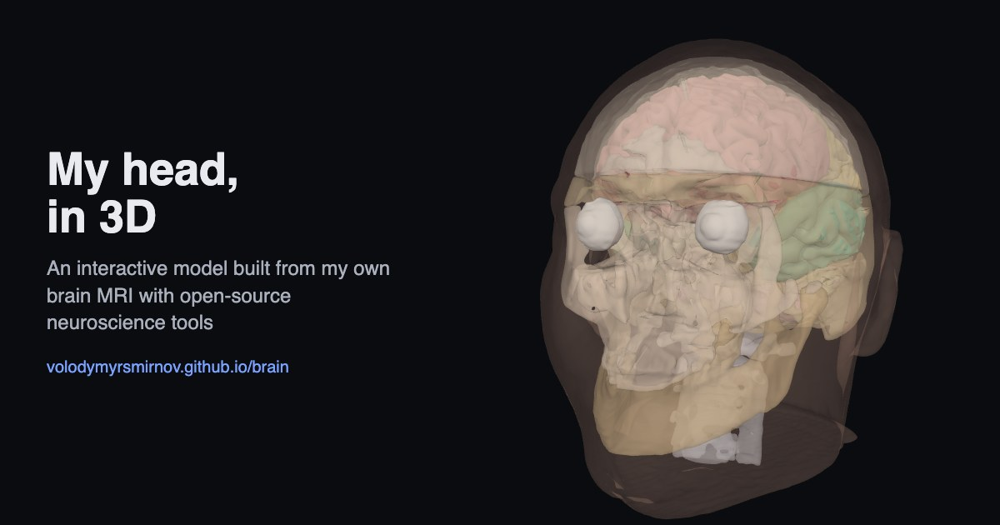](https://volodymyrsmirnov.github.io/brain/)

| | | |
|---|---|---|
| 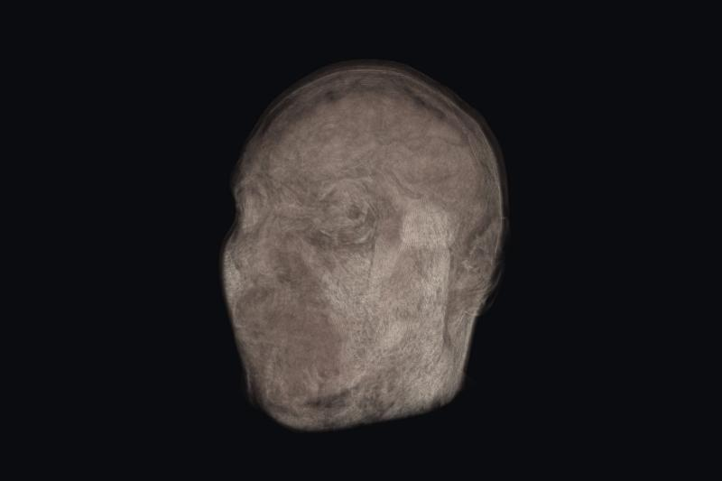 | 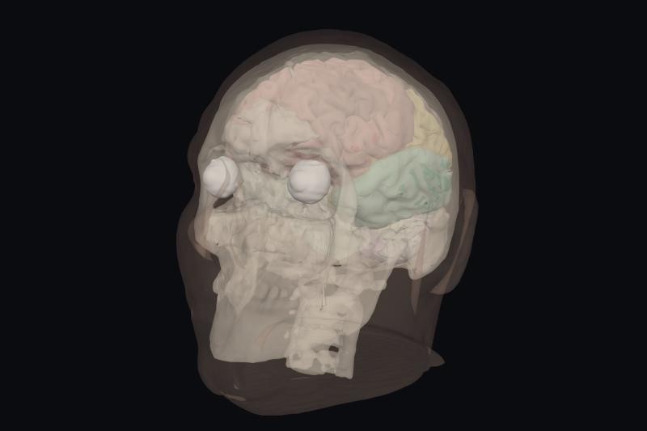 | 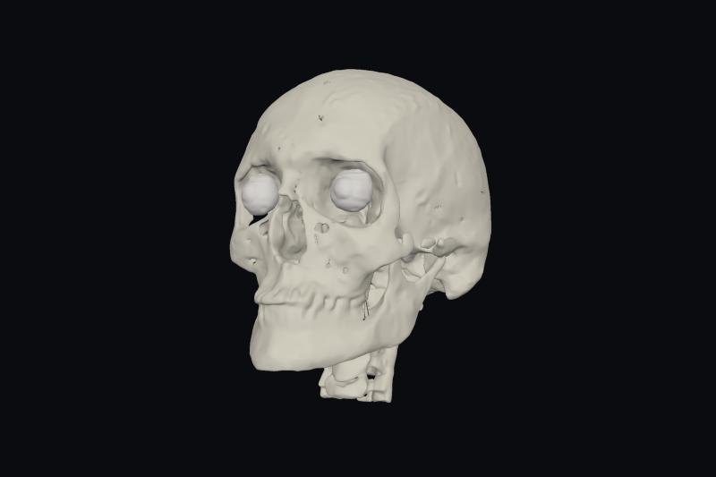 |
| *The raw scan as a 3D cloud* | *Glass head* | *Skull, split into bones (atlas-based estimate)* |
| 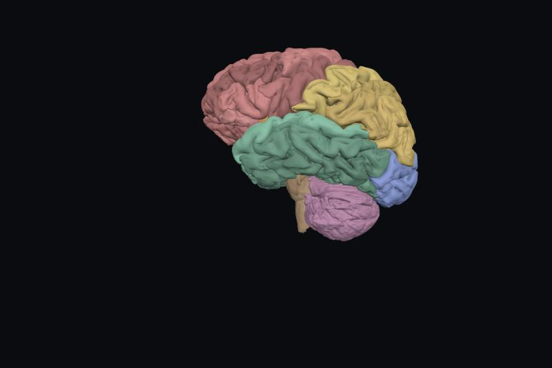 | 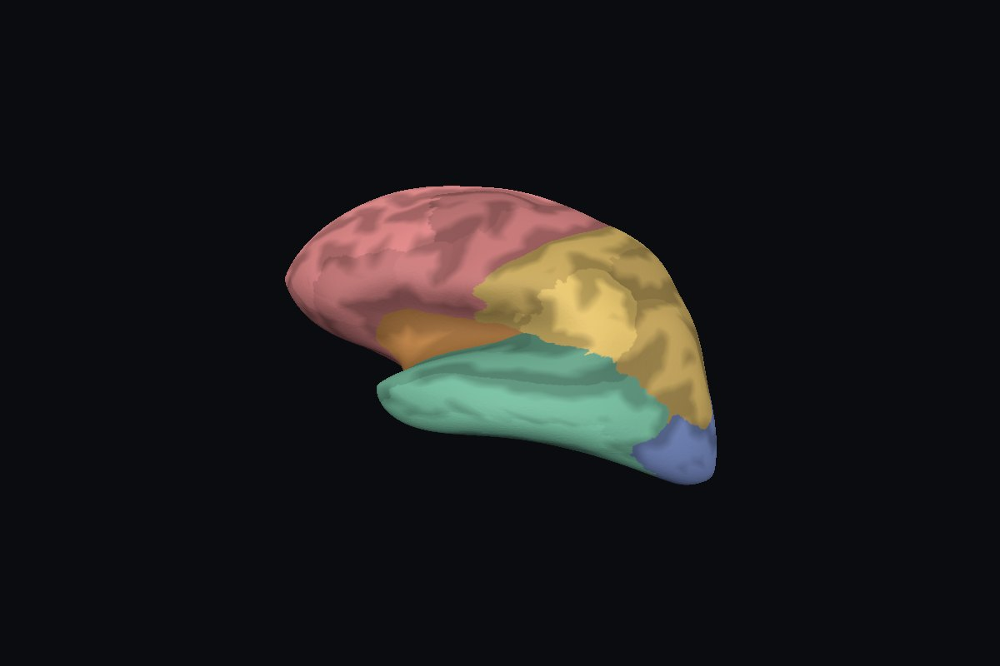 | 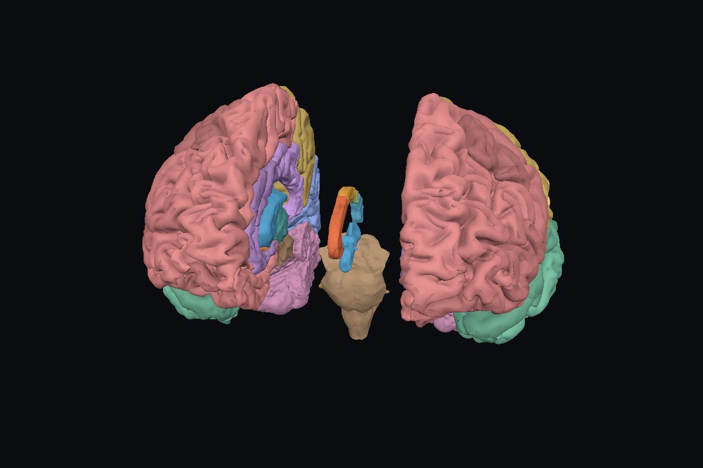 |
| *Cortex regions* | *The same cortex, inflated* | *Hemispheres apart, corpus callosum in the middle* |
| 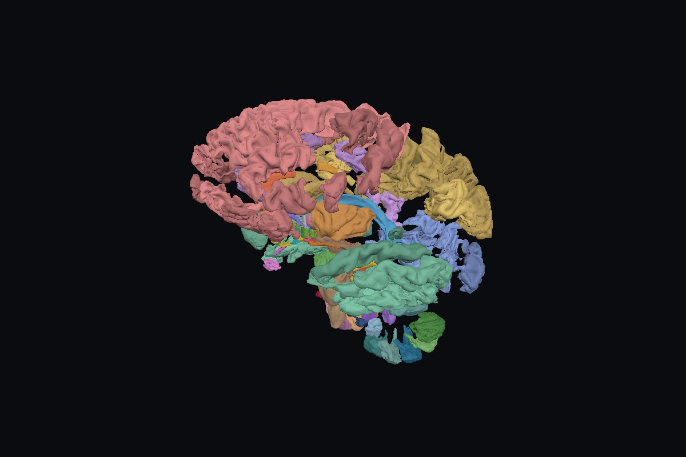 | | |
| *Every part pulled apart ("Explode" slider)* | | |
| 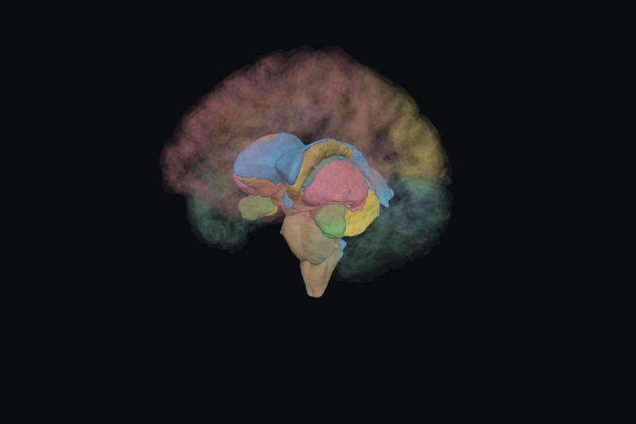 | 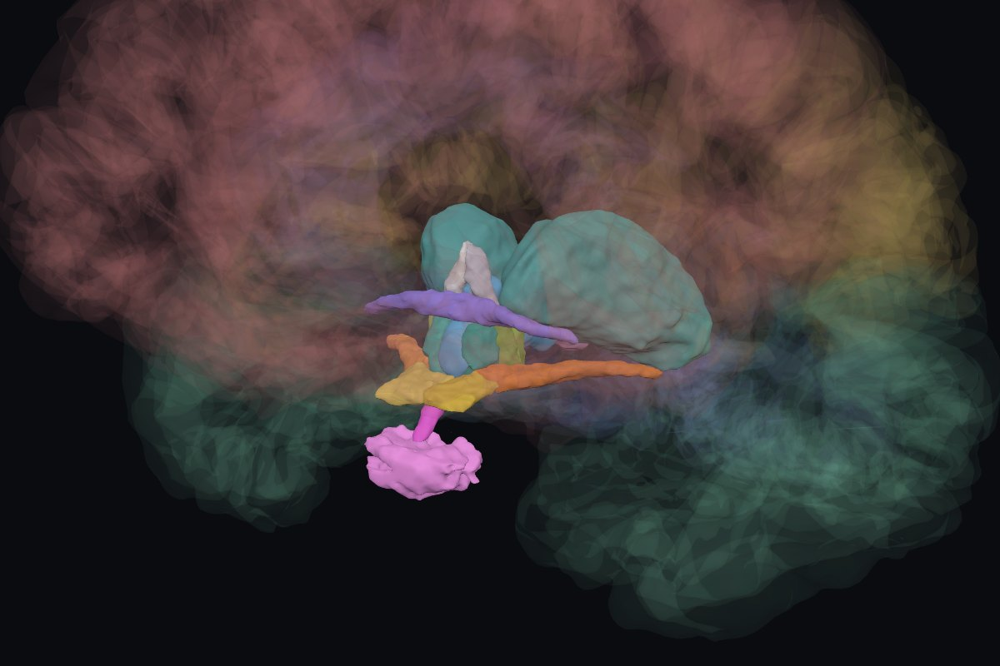 | 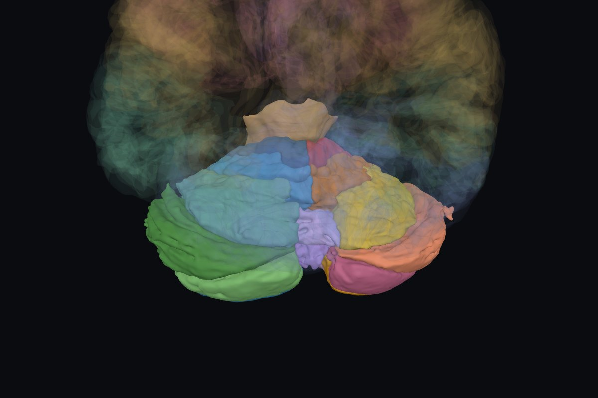 |
| *Deep structures in a glass brain* | *Hypothalamus, pituitary, optic chiasm* | *Cerebellar lobules* |
| 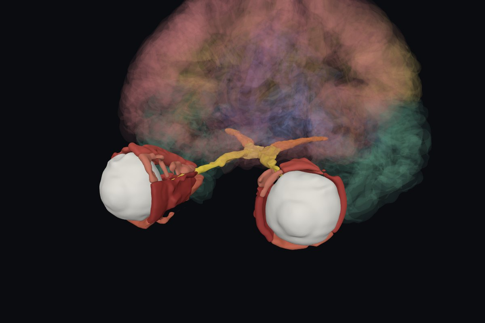 | 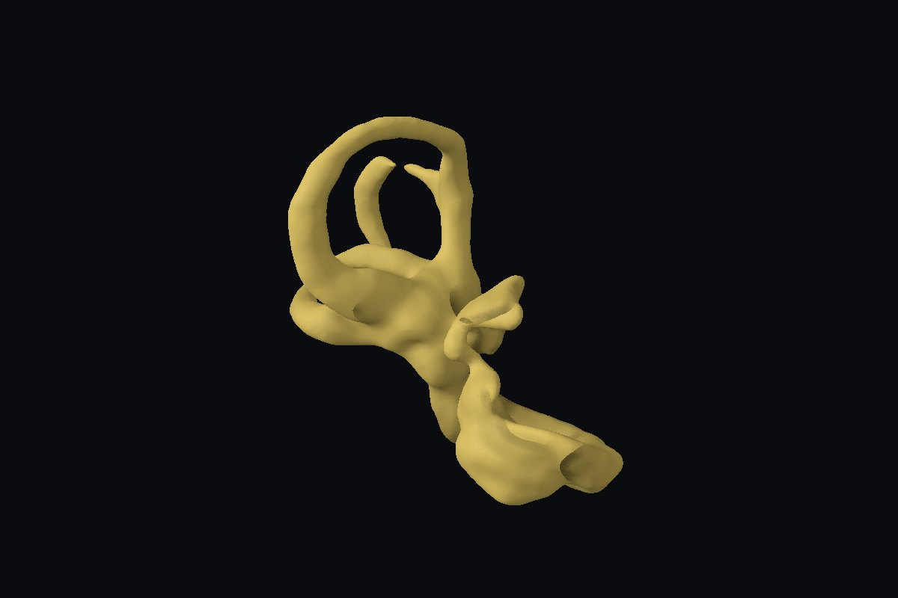 | 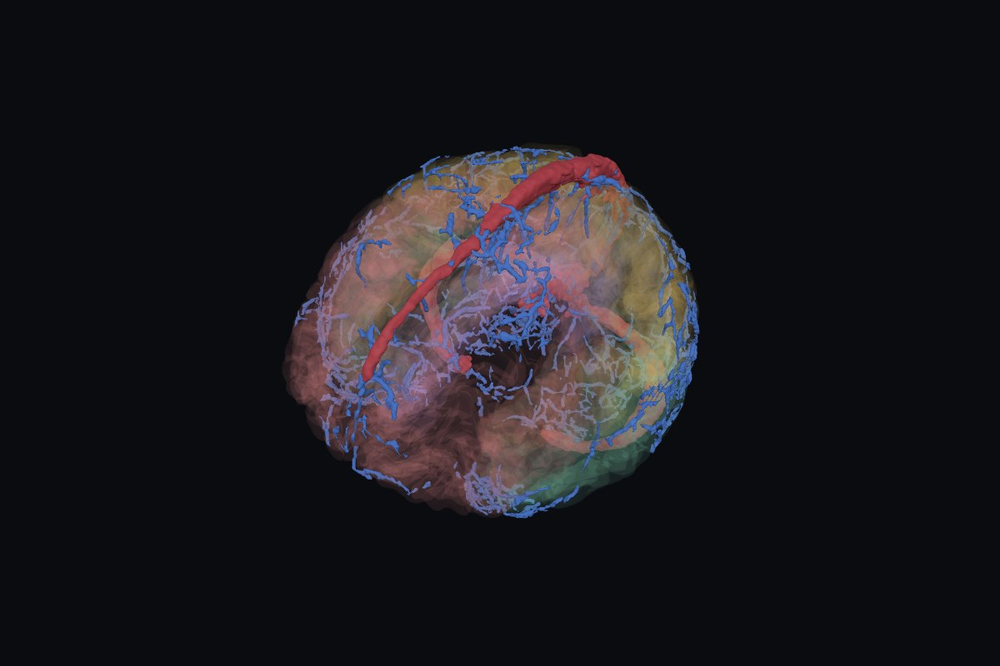 |
| *Eyes, optic nerves, eye muscles* | *Right inner ear, about 1 cm* | *Veins and dural sinuses* |
| 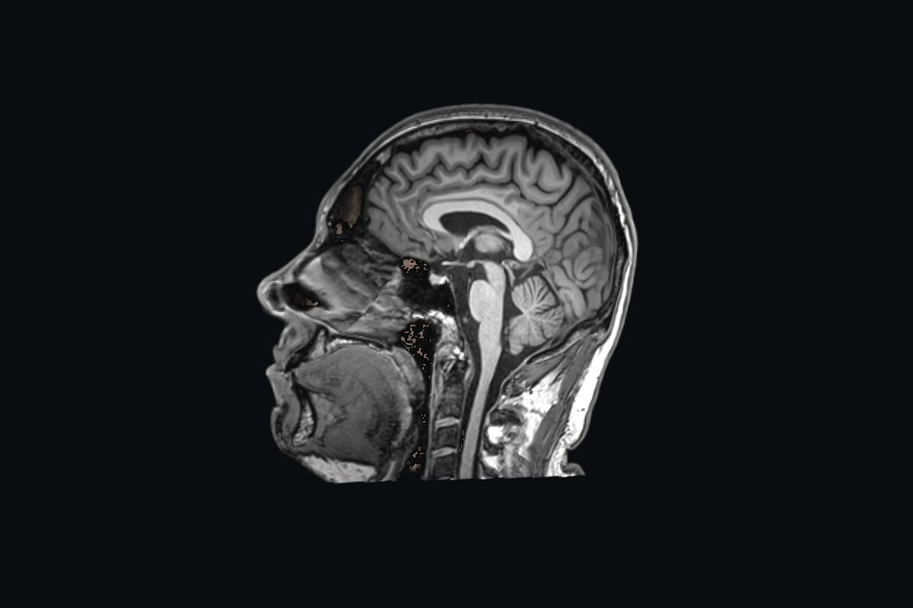 | | |
| *Virtual cut with the real MRI section* | | |

> **Not a medical tool.** It's a side project made out of curiosity. The algorithms are good but not perfect, and nothing
> here says anything about my health. It's my head, and I'm happy to share it.

---

## What's in the model

| Layer | Source scan | Tool / method | Notes |
|---|---|---|---|
| Raw volume | T1 MPRAGE | volume rendering in the browser (GLSL ray marching) | "Solid" and "X-ray" styles; cuts show the real MRI section |
| Skin | T1 | threshold + morphology | yes, that's my face |
| Skull, split into skull cap, skull base, face, lower jaw, C1, C2 and below | T1 + T2 TSE | SimNIBS **charm** + my own bone-part split | bone is dark on MRI, so this is an *estimate* |
| Eyes, optic nerves, eye muscles | T1 | charm eyeballs + cheapest-path nerve tracing + muscle cones | nerves are reliable, muscles approximate |
| Cortex, 31 regions per hemisphere in 6 lobes | T1 | **FastSurfer** (DKT atlas) | |
| Cortical surfaces (pial ↔ inflated) | T1 | charm surfaces + my own inflation | the "Inflate brain" slider |
| Deep structures: ventricles, thalamus, basal ganglia, hippocampus, amygdala, brainstem, white matter | T1 | FastSurfer | |
| Hypothalamus area: hypothalamus, mammillary bodies, fornix, optic chiasm and tracts, pituitary, pineal | T1 | FastSurfer **HypVINN** | |
| Cerebellum: lobules I–X and vermis | T1 | FastSurfer **CerebNet** | |
| Corpus callosum: genu, body, splenium | T1 | **FastSurfer-CC** | a midline slab, like in FreeSurfer |
| Inner ears: cochlea, vestibule, semicircular canals | T2 SPACE, 0.3 mm | automatic labyrinth search + canal-width filter | each about 1 cm across |
| Veins + dural sinuses | SWI (+ phase) + charm | Frangi vesselness, phase-based artefact map, gap bridging | some artefacts left near the skull base |

All of it adds up to 167 meshes and ~4.2 million triangles, compressed to ~11 MB of web data.

## Run it on your machine

```bash
git clone https://github.com/volodymyrsmirnov/brain.git && cd brain
python3 -m http.server -d docs 8000
# open http://localhost:8000
```

The viewer is a single static page (`docs/index.html`) plus data (`docs/data/`). It needs a local web server because
browsers don't let pages `fetch()` files from `file://` URLs. You don't need Git LFS just to view it.

## Repository layout

```
docs/                       the website (GitHub Pages root)
  index.html                viewer: three.js + three-mesh-bvh + Draco, no build step
  data/manifest.json        groups, layers, colours, sizes
  data/*.drc                Draco-compressed meshes (≤ 0.05 mm quantization error)
  data/volume.bin           1 mm T1 volume (uint8, delta-coded, gzip)
  img/                      README screenshots and og.jpg (link preview), made by pipeline/screenshots.py
data/                       ⚠ Git LFS
  raw/mri_study_anonymized.zip   the full study: 2,058 DICOM files, 23 series, headers cleaned
  derived/                  intermediate results, so you can skip the slow steps
    t1.nii.gz, brain_mask.nii.gz, aparc.DKTatlas+aseg.deep.mgz, charm_tissues.nii.gz
    hypothalamus_labels.*, cerebellum_lobules.*, corpus_callosum.*      (FastSurfer modules)
    skull_parts.*, orbit_labels.*, inner_ear_labels.nii.gz, veins.nii.gz
    surfaces/               pial / inflated cortical surfaces + per-vertex region and sulcal depth
    head_all.glb            every mesh in one glTF file, for Blender etc.
pipeline/
  setup.sh                  installs every tool (Homebrew, uv, Docker)
  run_all.sh                the whole pipeline, step by step, resumable
  anonymize_dicom.py        DICOM header cleaning
  seg_fastsurfer_extras.sh  HypVINN, CerebNet, FastSurfer-CC (+ export_fastsurfer_extras.py)
  seg_skull_parts.py        splits charm's bone into named parts
  seg_orbit.py              optic nerves and eye muscles
  seg_inner_ear.py          inner-ear labyrinths
  seg_veins.py              veins (SWI) + dural sinuses
  build_surfaces.py         cortical surfaces + inflation
  build_model.py            meshes + web data
  screenshots.py            README screenshots + link-preview image (needs Playwright)
```

## How I made it

Short version: one MRI, a stack of free research tools that neuroscientists use every day, and a lot of trial and error.
Long version, step by step:

### 1. Getting my data out

A routine clinical brain MRI ("RM Crânio-Encefálico") on a **Siemens MAGNETOM Skyra 3T** with a 20-channel head/neck coil:
23 series, 2,058 DICOM images. The clinic's patient portal (Biotronics3D 3Dnet) only shows images in a web viewer. That
viewer's own JavaScript uses a "download the whole study" job that isn't exposed anywhere in the UI; calling it directly
gave me the original DICOM files.

Series used in this project:

| Series | Type | Voxel size (mm) | TR / TE | Used for |
|---|---|---|---|---|
| 9 `t1_mprage_sag_p2_iso` | 3D T1-weighted MPRAGE | 0.6 × 0.5 × 0.5 | 2300 / 3.4 ms, TI 900 ms | almost everything; the reference space |
| 14 `pd-t2_tse_tra` (echo 2) | 2D T2-weighted TSE | 0.45 × 0.45 × 3.96 | 4550 / 82 ms | helps charm tell bone from fluid |
| 13 `t2_space_tra_iso` | 3D T2 SPACE | 0.32 × 0.32 × 0.30 | 1400 / 154 ms | inner ear |
| 17 / 16 `t2_qswi_tra` | SWI magnitude / phase | 0.7 × 0.7 × 1.7 | 27 / 20 ms | veins / artefact map |

The rest (FLAIR, diffusion trace/ADC, coronal T2, ear reconstructions, SWI mIP) is in the archive too. The FLAIR was
tried for the skull (see below); the diffusion series are trace/ADC only, so there's no tractography.

### 2. Cleaning the headers ([`anonymize_dicom.py`](pipeline/anonymize_dicom.py))

I'm not hiding whose head this is, but DICOM headers carry a lot of record-keeping data that doesn't belong in a public
repo (patient and accession numbers, date of birth, the clinic's address, the names of the doctors). So before anything
was committed, every header was scrubbed, roughly following the DICOM PS3.15 Basic profile:
- all person names were blanked;
- patient ID, birth date, address and other identifiers were removed;
- institution, station and device serial number were removed;
- accession and study IDs were removed;
- all dates were blanked;
- every UID was replaced with a fresh one;
- all private vendor tags were stripped.

Sex, age and every acquisition parameter were kept. The portal's `DICOMDIR` and `Readme.html` were dropped. A byte-level
search confirmed that none of the original identifiers remain, and the cleaned files convert to **voxel-identical** volumes.

> The images themselves of course show my face. It's a 3D head scan, and that's fine with me.

### 3. DICOM → NIfTI

[`dcm2niix`](https://github.com/rordenlab/dcm2niix) converts each series to compressed NIfTI. All series share the
scanner's coordinate system, so they line up without registration. Every later step works in **world RAS millimetres**.

### 4. Skull stripping

[SynthStrip](https://surfer.nmr.mgh.harvard.edu/docs/synthstrip/) (FreeSurfer, in Docker) predicts a brain mask from the T1.
The veins step uses it.

### 5. Brain segmentation

[FastSurfer](https://github.com/Deep-MI/FastSurfer) v2.6 (`--seg_only`, native 0.5 mm mode, on the Apple GPU via PyTorch
MPS) labels ~100 structures in FreeSurfer's `aparc.DKTatlas+aseg` scheme: 31 cortical regions per hemisphere
(Desikan–Killiany–Tourville atlas), plus subcortical structures, ventricles, cerebellum and brainstem. The cortical regions
are grouped into frontal, parietal, temporal and occipital lobes, the cingulate gyrus and the insula.

Three more FastSurfer modules run on top of that segmentation ([`seg_fastsurfer_extras.sh`](pipeline/seg_fastsurfer_extras.sh)),
none of which needs a FreeSurfer licence:
- **HypVINN:** 24 labels around the hypothalamus. These are the hypothalamic subregions, mammillary bodies, fornix,
  anterior commissure, optic chiasm and tracts, pituitary gland and stalk, and pineal gland. It ran on the T1 only: the
  FLAIR has the wrong contrast, the T2 TSE is too thick, and the T2 SPACE slab covers only a third of the region.
  At 0.5 mm, HypVINN's own clean-up silently drops the optic tracts (its connectivity test assumes a coarser voxel), so
  the helper patches that test.
- **CerebNet:** 25 cerebellar lobules and vermis parts. CerebNet works at 1 mm; the result is lifted onto the 0.5 mm grid
  and clipped to the main cerebellum mask, so the lobules tile it exactly.
- **FastSurfer-CC:** the corpus callosum, split into genu, three body parts and splenium (Hofer–Frahm scheme). Like in
  FreeSurfer it's a ~5 mm slab at the midline; the fibres fanning out into the hemispheres can't be told apart on a T1.

### 6. Cortical surfaces and inflation ([`build_surfaces.py`](pipeline/build_surfaces.py))

FastSurfer gives the cortex as voxels; for the "Inflate brain" slider I needed real surfaces where every point on the
folded (pial) surface has a matching point on the inflated one.
- **Surfaces:** SimNIBS `charm --surfaces` runs **TopoFit**, a deep-learning model that deforms a sphere-like template
  onto the cortex. The white (grey/white boundary) and pial (outer) surfaces come out hole-free and share one mesh,
  vertex for vertex. That's a second, T1-only charm run, and no FreeSurfer licence is needed.
- **Inflation:** FreeSurfer-style. The white surface is smoothed 3000 times while its area is kept constant, and the
  movement along the normal is summed into **sulcal depth** (dark = deep groove). For the viewer the inflated surface is
  scaled back to the size of the brain, so it doesn't burst out of the head mid-morph.
- **Regions:** each vertex samples the FastSurfer DKT labels at 5 points through the cortex and takes a majority vote.
  The medial wall (where the hemispheres touch) has no region and shows grey.
- **Size:** decimated to 150k vertices per hemisphere with the same vertex groups on all surfaces, so the
  correspondence survives. The median cortical thickness comes out at 2.9–3.0 mm, about what you'd expect.

### 7. Head tissues and skull

Bone is nearly invisible on MRI. My first attempt (thresholding the dark band between scalp and brain) only produced a
rough cap.

[SimNIBS](https://simnibs.github.io/simnibs/) 4.6 `charm` does much better: it registers the T2 TSE to the T1, fits a
probabilistic head atlas with a Bayesian (samseg) model, and labels skin, compact and spongy bone, CSF, eyes, muscle,
blood and more.

The back of the skull has ripples from the T2 scan's 4 mm slices. I tried charm with the 0.5 mm 3D FLAIR and with the T1
alone, and measured surface roughness on all three. The FLAIR removes the stair-steps but adds a finer bumpy texture,
holes in the face and a ragged jaw. After smoothing, the original T2 TSE version still looks best, so it stays.

**Bone parts** ([`seg_skull_parts.py`](pipeline/seg_skull_parts.py)): charm gives one "bone" label, which I split into
skull cap, skull base, facial skeleton, lower jaw, C1 (atlas) and the cervical vertebrae below it.
- Seeds come from simple landmarks: the eyes, the spinal cord (charm's white matter outside the brain) and the foramen
  magnum (the lowest point of the cerebellum).
- The seeds grow over the bone by watershed on bone thickness, so borders land at the jaw joints and between skull and spine.
- Upper and lower teeth touch on MRI, so the jaws are cut at the bite plane, found as the narrowest point of the dental arch.
- MRI can't see sutures, so the face/cranium and cap/base borders are geometric cuts (that's why they're straight lines).

**Optic nerves and eye muscles** ([`seg_orbit.py`](pipeline/seg_orbit.py)): on T1 the orbit is bright fat with dark
nerve and muscles in it.
- Each optic nerve is the cheapest path from the back of the eyeball to the chiasm through dark tissue. It may not go
  through bone, eye, air or brain, and the optic canal is where the path comes closest to bone.
- The muscles are the dark tissue inside a cone from the canal to the eyeball, split by angle into the four recti and
  the superior oblique.
- The nerves are reliable; the individual muscle shapes are approximate.

### 8. Inner ear ([`seg_inner_ear.py`](pipeline/seg_inner_ear.py))

On the 0.3 mm T2 SPACE scan the fluid-filled labyrinth is bright inside dark bone. The script finds both labyrinths on
its own:
1. It searches 22–62 mm to each side of the brainstem.
2. It removes thick fluid (cisterns, the internal auditory canal).
3. It scores the remaining bright pieces by how much of their surroundings is bone, and takes the best one per side.

The internal auditory canal touches the cochlea, so it's cut away by modelling it as a cylinder along its axis.
Manual regions can still be passed with `--roi-left/--roi-right`. The result is the cochlea, the vestibule and the three
semicircular canals.

### 9. Veins and dural sinuses ([`seg_veins.py`](pipeline/seg_veins.py))

On SWI, oxygen-poor blood is dark. The steps:
1. Normalise the SWI and compute Frangi vesselness for dark tubes 0.5–1.8 mm wide, inside the SynthStrip brain mask.
2. Build an **artefact map** from the SWI phase. Near air (sinuses, ear canals) the phase wraps, and that's exactly
   where the fake "veins" came from. Risky areas then need about 3× stronger evidence.
3. Run hysteresis thresholding so veins stay continuous across the 1.7 mm slices, plus a local-density filter
   (real veins are sparse threads, artefacts are a dense mesh).
4. Pieces in risky areas must be tube-shaped.
5. Bridge gaps of up to 5 mm along the vessel direction where the vesselness supports it (this joined 381 pieces into 47).
6. Add the **dural sinuses** (superior sagittal, straight, transverse, sigmoid) from charm's blood label, keeping only
   voxels that are also dark on SWI. The carotid arteries are dark too, so they're removed by position.

### 10. Meshes and web export ([`build_model.py`](pipeline/build_model.py))

Every label becomes a surface:
1. Crop to the label and apply a light Gaussian blur.
2. Run marching cubes ([scikit-image](https://scikit-image.org)).
3. Decimate the mesh ([fast-simplification](https://github.com/pyvista/fast-simplification)).
4. Apply Taubin smoothing ([trimesh](https://trimesh.org)).
5. Move it to world millimetres through the volume's affine, centred on the T1.

New label files are picked up automatically from `data/derived/*.nii.gz` + `.json` (see `LABEL_SETS`), and labels that
duplicate another source are skipped (for example, the optic nerves come from `seg_orbit.py`, the chiasm from HypVINN).

Meshes are **Draco**-compressed with quantization picked per mesh (≤ 0.05 mm error). The 1 mm T1 volume is delta-coded and
gzipped. Together that's ~11 MB, down from 28 MB in the first version.

### 11. Viewer ([`docs/index.html`](docs/index.html))

Plain HTML + [three.js](https://threejs.org), with no build step:
- **Loading:** the volume rendering shows up first; the meshes stream in behind it.
- **Picking:** hover and click run on [three-mesh-bvh](https://github.com/gkjohnson/three-mesh-bvh), so picking stays fast
  across 4M triangles. Every structure has a short plain-language description.
- **Volume rendering:** a custom GLSL ray marcher over a 3D texture. "Solid" composites front to back with gradient
  shading; "X-ray" accumulates absorption.
- **Cuts:** cut planes clip both the meshes and the volume. Where a ray leaves the removed half it shows the MRI
  intensity, so the cut face looks like a real slice.
- **Inflate brain:** the cortical surfaces morph between pial and inflated on the GPU (morph targets).
- **Split and Explode:** "Split brain" moves the hemispheres apart. "Explode" pulls every brain part away from the
  centre: cortex regions move with their lobe, so lobes separate as whole pieces, plus a little on their own, so the
  gyri separate too. Deep structures, cerebellar lobules, the hypothalamus and the corpus callosum each move along
  their own direction.
- **Tour:** the guided views double as steps of a narrated "Take the tour" story with camera flights.
- **Shading:** screen-space ambient occlusion (GTAO), switched off automatically for translucent scenes.

## Do it yourself

You need macOS on Apple Silicon (tested), Homebrew, Docker (OrbStack works), and ~30 GB of disk space.

```bash
git lfs install && git lfs pull      # fetch data/ (~0.5 GB)
pipeline/setup.sh                    # tools: dcm2niix, FastSurfer, SimNIBS, SynthStrip
pipeline/run_all.sh                  # ~3 hours; resumable, writes data/derived and docs/data
```

Most of the time goes into SimNIBS charm (~1 h per run; it runs twice: head tissues, and the cortical surfaces) and
HypVINN.

**Is it reproducible?** I re-ran the whole pipeline from scratch in a clean copy (starting from the anonymized DICOM
zip with an empty `data/derived`) and compared it with the committed results using
[`compare_derived.py`](pipeline/compare_derived.py):
- FastSurfer, HypVINN, CerebNet, FastSurfer-CC, the inner ears and the cortical surfaces came out **bit-identical**.
- SimNIBS charm's atlas fitting isn't bit-exact between runs: head tissues Dice 0.995. The steps built on it are
  close too: skull parts 0.993, veins 0.998, orbits 0.975. The worst single structure is the thin right optic nerve
  (Dice 0.89).
- The rebuilt web model has the same 167 layers. The full run took 3 hours on an M5 MacBook.

To regenerate only the web model from the committed intermediate results (a few minutes, Python only):

```bash
uv venv .venv && VIRTUAL_ENV=.venv uv pip install -r pipeline/requirements.txt
.venv/bin/python pipeline/build_model.py data/derived docs/data work/meshes
```

To do this with **your own** MRI:
1. Clean the headers with `anonymize_dicom.py`.
2. Adjust the series names at the top of `run_all.sh`.

Without an SWI or a thin-slice T2 scan, the veins and inner-ear steps won't apply. Thresholds in the orbit, ear and vein
steps were tuned on my scan, so check the results.

## Things that aren't perfect

- **Skull:** an atlas-guided estimate from MRI, not a CT. The overall shape is right; thin bones and sutures are not.
  The lower jaw also stops about 1 cm short of the real bottom of the chin.
  Some face/cranium and cap/base borders are straight cuts, and C2–C7 are one piece.
- **Eye muscles:** roughly in the right places, but the exact shapes are approximate.
- **Veins:** a small cluster of artefacts remains near the sphenoid bone, and a few real veins at the frontal base are missing.
  The sinuses come from an atlas, so they're smooth and slightly thick.
- **Corpus callosum:** only the midline slab.
- **Labels in general:** automatic segmentation can be off by a millimetre or two at region borders.

## Publishing your own copy

1. Create an empty GitHub repository.
2. Push it (`git push -u origin main`); the LFS objects upload automatically (~0.5 GB).
3. On GitHub, open **Settings → Pages** and set **Deploy from a branch → `main` / `/docs`**.

GitHub Pages can't serve Git LFS files, which is why `docs/` is in plain git (~11 MB) while only `data/` uses LFS. Free
GitHub accounts have a limited LFS quota, so check it before sharing widely.

## Credits

- **FastSurfer:** Henschel et al., *NeuroImage* 2020; Henschel et al., *NeuroImage* 2022 (FastSurferVINN, high-resolution)
- **HypVINN:** Estrada et al., *Imaging Neuroscience* 2023
- **CerebNet:** Faber et al., *NeuroImage* 2022
- **FastSurfer-CC:** Pollak et al., *Imaging Neuroscience* 2026; subdivision after Hofer & Frahm, *NeuroImage* 2006
- **SimNIBS charm:** Puonti et al., *NeuroImage* 2020
- **SynthStrip:** Hoopes et al., *NeuroImage* 2022
- **DKT atlas:** Klein & Tourville, *Frontiers in Neuroscience* 2012
- **Frangi vesselness:** Frangi et al., *MICCAI* 1998
- **dcm2niix:** Li et al., *J Neurosci Methods* 2016
- three.js, three-mesh-bvh, Draco, scikit-image, trimesh, nibabel, pydicom, pyvista

## License

- **Code** (`pipeline/`, `docs/index.html`): [MIT](LICENSE)
- **Imaging data and 3D model** (`data/`, `docs/data/`): [CC BY 4.0](LICENSE-DATA). Please don't draw conclusions about my health from it.
